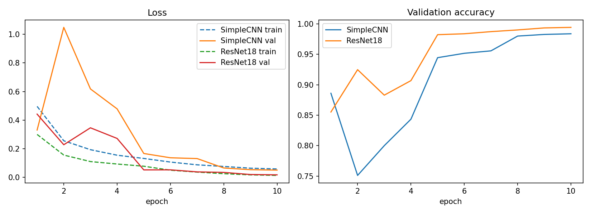
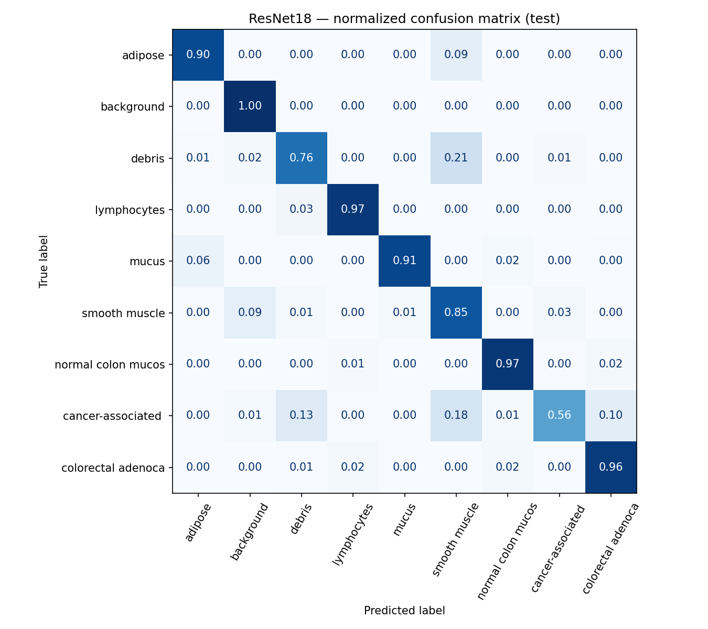
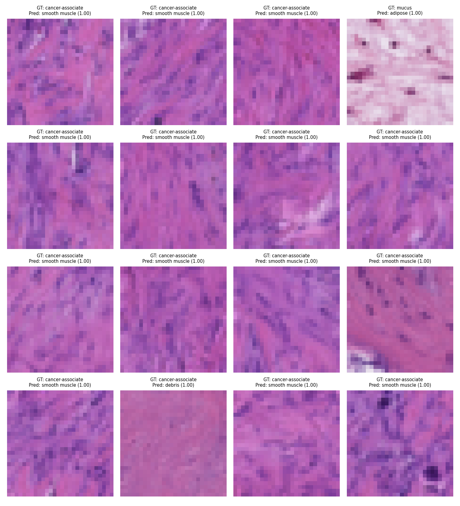

# 병리 조직 이미지 분류 — PathMNIST × PyTorch

대장 병리 슬라이드(WSI)에서 추출한 조직 패치 이미지를 **9개 조직 유형**으로 분류하는 딥러닝 실험입니다.
직접 설계한 CNN과 사전학습 ResNet18을 같은 조건에서 비교하고, 오류 분석까지 진행했습니다.

## 데이터
- **PathMNIST** ([MedMNIST v2](https://medmnist.com/)) — NCT-CRC-HE-100K 기반 대장 조직 패치
- train 89,996 / val 10,004 / test 7,180장, 9개 클래스
- 이미지 크기: 28×28

## 방법
| 단계 | 내용 |
|---|---|
| 전처리 | ImageNet 정규화, 학습 시 상하·좌우 뒤집기 + 90° 단위 회전 증강 (조직은 방향과 무관) |
| 모델 | ① SimpleCNN (3블록 합성곱, baseline) ② ResNet18 (ImageNet 사전학습, 작은 입력에 맞게 stem 수정) |
| 학습 | CrossEntropy, AdamW(lr 1e-3), Cosine LR, 10 epochs, batch 128 |
| 모델 선택 | 검증 AUC 최고 시점 체크포인트 사용 |
| 평가 | 테스트셋 Accuracy, macro OvR AUC, 혼동행렬, 클래스별 precision/recall |
| 재현성 | seed 42 고정, 설정·라이브러리 버전·결과를 `results.json`에 기록 |

## 결과
| 모델 | Test Accuracy | Test AUC | Best Val AUC |
|---|---|---|---|
| SimpleCNN | 0.8947 | 0.9883 | 0.9997 |
| **ResNet18** | **0.9050** | **0.9915** | 1.0000 |

- ResNet18이 정확도·AUC 모두 근소하게 앞섬 (MedMNIST v2 논문의 ResNet-18(28) 기준치와 비슷한 수준)
- 검증 정확도는 약 99%였지만 테스트는 약 90% → 학습·검증과 테스트 데이터의 출처(병원)가 달라 생기는 **도메인 차이**로 판단

## 오류 분석
- **잘 맞힌 조직**: background 100%, lymphocytes·normal colon mucosa 97%, colorectal adenocarcinoma epithelium 96%
- **가장 약한 조직**: cancer-associated stroma (recall 55.6%) — smooth muscle(18%), debris(13%)로 착각
- **원인에 대한 생각**: 틀린 이미지를 직접 보니 기질과 평활근은 색과 결이 거의 같아 사람 눈으로도 구분이 어려웠다. 점액을 지방으로 착각한 경우는 둘 다 연한 색이라 28×28 해상도에서 질감 차이가 사라진 것으로 보인다.
- **주의할 점**: 모델은 이런 오답에도 확신도 1.00을 냈다. 틀릴 때도 확신하는 모델은 진단 보조 도구로서 위험할 수 있다.

## 배운 점과 다음 단계
- 같은 조건에서 하나씩만 바꿔 비교해야 결과 차이의 원인을 말할 수 있다
- 검증 점수만 보면 안 되고, 다른 출처의 데이터로 따로 평가해야 실제 성능이 보인다
- 다음에 해 볼 것: 해상도 64×64로 키우기, 색 증강(color augmentation)·염색 정규화(stain normalization)로 도메인 차이 줄이기

## 실행 방법
1. `pathmnist_classification.ipynb`를 Google Colab에서 열기
2. 런타임 → 런타임 유형 변경 → **T4 GPU**
3. 런타임 → 모두 실행
